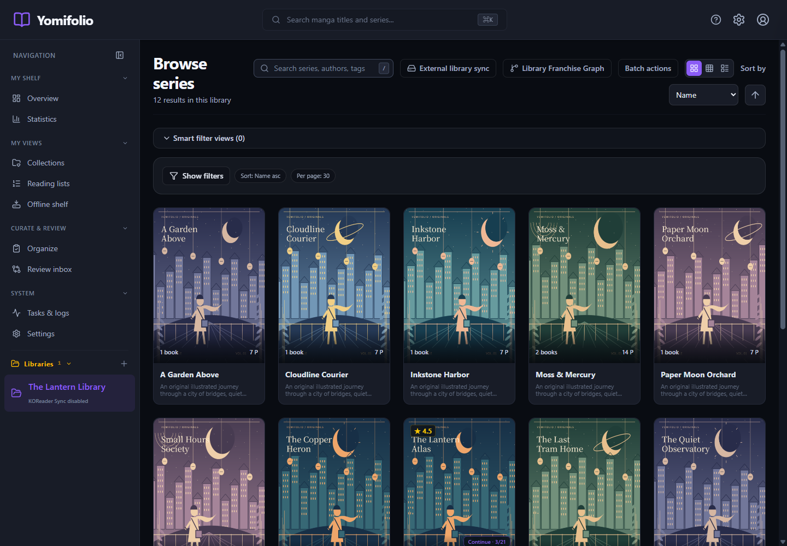
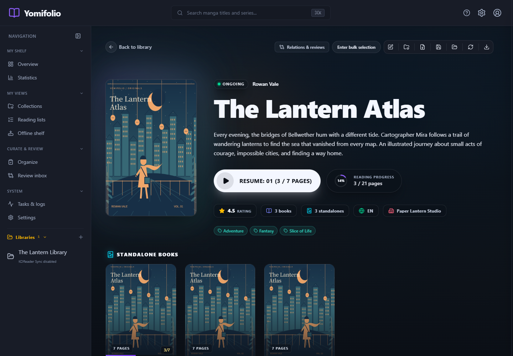
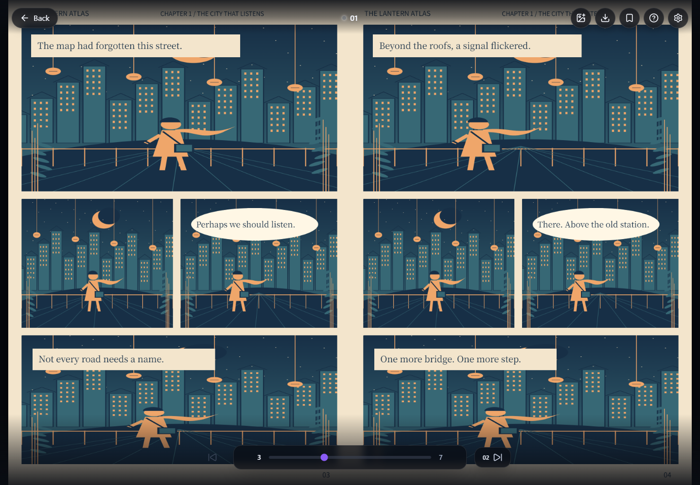

# Yomifolio

**Self-hosted manga & comic server**

English · [简体中文](README.zh-CN.md) | [Download](https://github.com/Nieole/yomifolio/releases/latest) · [Quick start](#quick-start) · [Documentation](#documentation)

Turn your local manga, comics, and artbook archives into a browsable library. Read in your browser, save books for offline reading, or connect through OPDS, the Mihon API, and KOReader sync—with different capabilities for each client.

Browse your collection by series, then pick up where you left off. Screenshots use original demonstration artwork, not bundled manga or a downloadable content collection.

## Why Yomifolio?

- **Keep your collection local.** Scan ZIP/CBZ and RAR/CBR files into an embedded SQLite index. Basic library browsing and reading need no cloud database or LLM.
- **Find your next read.** Search series and books, build collections and reading lists, and review metadata suggestions before applying them.
- **Read your way.** Switch between paged, double-page, and vertical reading on desktop or mobile. Download books into this browser for offline use, or enable a supported client integration.
- **Share a server, not your reading history.** Each account has its own progress, bookmarks, comments, and reading statistics; administrators manage the shared library.

## Quick start

1. Download the binary for your platform from [Releases](https://github.com/Nieole/yomifolio/releases/latest): Linux AMD64, Windows AMD64, or macOS ARM64. Use the **actual asset filename** on the release page: older releases may still use `manga-manager` names; current source builds and release workflow outputs use `yomifolio`. This documentation and its screenshots describe current source; for downloaded binaries, consult that release’s notes for available features.
2. Put it in a writable working directory. On Linux/macOS, make the downloaded file executable (`chmod +x ./ACTUAL_FILENAME`), then run `./ACTUAL_FILENAME`; in PowerShell, run `.\ACTUAL_DOWNLOADED_FILENAME`. These are placeholders—use the actual downloaded filename, including `.exe` on Windows.
3. On the server, open [http://localhost:8080](http://localhost:8080), create the first administrator, add an absolute library path in Settings, and scan. Use archives you are authorized to store and read. The web interface supports English and Simplified Chinese.

> **Set up locally or on a trusted network before exposing the server.** It listens on `0.0.0.0:8080` by default and has no built-in HTTPS. Protected Web APIs reject access before setup; the public setup endpoint can still be claimed by anyone who can reach it. For Internet access, use a TLS reverse proxy and configure trusted proxies / secure cookies. See [deployment and security](docs/getting-started.md#deployment-and-security).

The default `config.yaml` is created in the **working directory**, not inside `data/`. `-data-dir` controls **logs only**; database and cache locations come from configuration (defaults: `./data/manga.db`, `./data/cache`). See [paths, configuration, and upgrades](docs/getting-started.md).

## A closer look

### Organize a series

Keep volumes, metadata, and reading state together. Review scraped suggestions, lock fields you want to preserve, and organize related series into collections.

### Read on desktop or phone

Choose page turns or vertical scrolling, reading direction in paged mode, fitting, bookmarks, and image options. Offline downloads stay in the current browser; storage availability and eviction depend on that browser. Logout or user changes can clear local books; they are not permanent backups.

The mobile view is a real browser capture at a touch-enabled phone-sized viewport, not a physical-device photograph. [Screenshot provenance](images/README.md).

## Clients and integrations

| Entry point | What it provides | Setup and limits |
| --- | --- | --- |
| Web reader | Browsing, paged/vertical reading, per-user progress and bookmarks, browser-local offline books | Session cookie + CSRF. Offline support requires Service Worker / Cache Storage, normally HTTPS or localhost. |
| OPDS 1.2 | Catalog navigation, archive acquisition, and PSE page streaming | **Off by default.** Enable in settings; site username/password via HTTP Basic. Client support varies; do not assume progress write-back. Catalog: `/opds/v1.2/`. |
| Mihon API | Series/books, filters, collections, reading lists, and a progress write endpoint | **Off by default.** HTTP Basic; requires an adapter implementing this API (`/api/mihon/v1`). Server support does not imply a published extension or inclusion in an upstream extension repository. |
| KOReader | kosync-compatible device progress storage and matching to library books | **Off by default**, as is self-registration. Separate per-account sync keys; bind an account to a site user and match book identities before expecting site progress updates. Default base path: `/koreader`. |

Accounts created by an administrator must first change their password in the web UI before using any reading protocol. Arbitrary third-party readers do not automatically write progress back.

Online metadata sources and LLM-assisted metadata, grouping, and recommendations are **optional** and may contact external services. Optional waifu2x / Real-CUGAN processing requires separately installed executables and suitable hardware. Neither is required for basic reading. See [features and optional tools](docs/features.md).

## Documentation

- [Getting started, deployment, configuration, and upgrades](docs/getting-started.md)
- [Library management, reader features, clients, and optional tools](docs/features.md)
- [Building, testing, and development](docs/development.md)
- [Example configuration](config.example.yaml) · [Changelog](CHANGELOG.md)

## Contributing and feedback

Read [CONTRIBUTING.md](CONTRIBUTING.md) for contribution and safe reporting guidance. For bugs and feature requests, [open an issue](https://github.com/Nieole/yomifolio/issues/new/choose) with the version, platform, steps to reproduce, and sanitized logs. Do not post credentials or private library files. Report security issues using the [private-channel guidance](SECURITY.md).

## License

[Apache License 2.0](LICENSE) · Yomifolio contributors. Third-party components retain their own licenses; see [notices and outstanding release checks](THIRD_PARTY_NOTICES.md). The code license does not grant rights to third-party comics or artwork.
