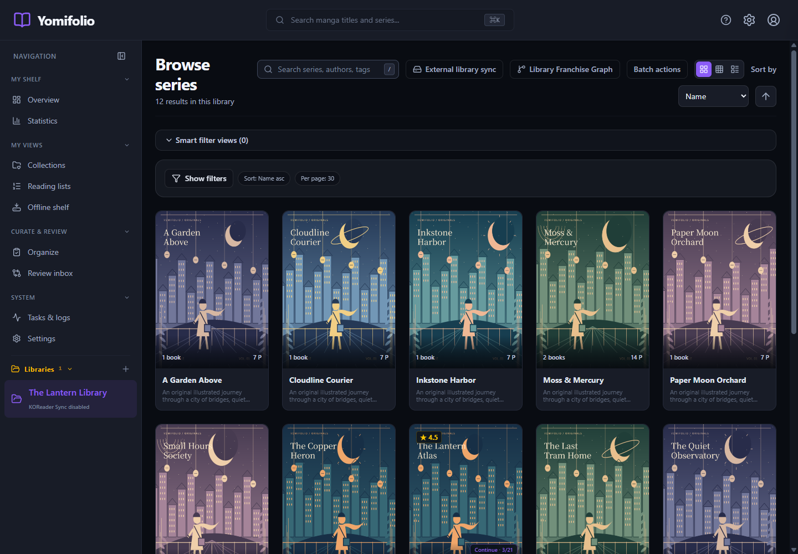
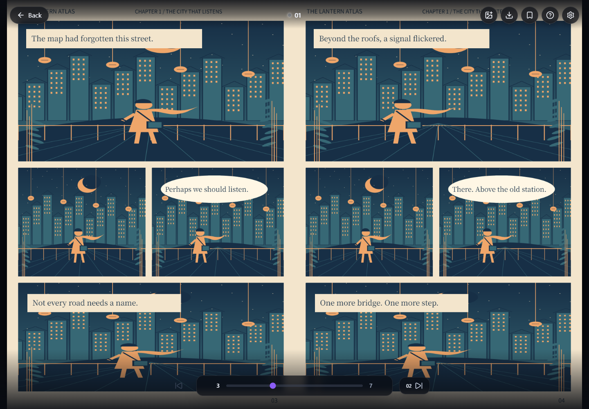

# Yomifolio

**Self-hosted manga & comic server · 自托管漫画与画集服务器**

[English](README.md) · 简体中文 | [下载](https://github.com/Nieole/yomifolio/releases/latest) · [快速上手](#快速上手) · [深入文档](#深入文档)

把硬盘上的漫画、画集压缩包整理成可浏览的系列书库，在浏览器阅读、下载到当前浏览器离线阅读，或按需接入 OPDS、Mihon API 与 KOReader 同步。不同客户端的能力各有边界，不意味着任意客户端都能同步阅读进度。

从系列封面找到想读的书，再从上次的位置继续。截图使用原创演示封面与页图，不代表项目附送真实漫画资源或提供内容下载库。

## 为什么使用 Yomifolio？

- **藏书留在本地。** 扫描 ZIP/CBZ、RAR/CBR，以内嵌 SQLite 建立索引；基础管理与阅读不需要云数据库或大模型。
- **让藏书更容易找到。** 搜索系列和卷册，建立合集、智能筛选与阅读列表；先审核元数据建议，再决定是否应用。
- **按习惯阅读。** 桌面和手机支持翻页、双页对开与纵向瀑布流；可下载到当前浏览器离线阅读，或启用适配的客户端协议。
- **共享书库，不混淆阅读记录。** 各账号分别保存进度、书签、系列短评与阅读统计；管理员负责公共藏书和系统维护。

## 快速上手

1. 从 [Releases](https://github.com/Nieole/yomifolio/releases/latest) 下载适配平台的二进制：Linux AMD64、Windows AMD64 或 macOS ARM64。以发布页实际文件名为准；旧 release 可能仍叫 `manga-manager`，当前源码构建及发布工作流产物叫 `yomifolio`。本文与截图描述当前源码，下载版本的功能以其 release notes 为准。
2. 放进服务账号有写入权限的工作目录。Linux/macOS 执行 `chmod +x ./实际下载文件名` 后运行 `./实际下载文件名`；PowerShell 执行 `.\实际下载文件名`，文件名包含 `.exe`，不再追加扩展名。
3. 在服务器本机打开 [http://localhost:8080](http://localhost:8080)，创建首个管理员，在设置中添加藏书的**绝对目录**并扫描。请只使用有权存储和阅读的文件。网页支持简体中文和英文。

> **先在本机或可信网络初始化，再对外开放。** 默认监听 `0.0.0.0:8080`，不内置 HTTPS。未初始化时受保护的 Web API 拒绝访问，但任何能到达公开 setup 入口的人仍可能抢先成为管理员。公网部署使用 TLS 反向代理并配置可信代理和安全 Cookie，见[部署与安全](docs/getting-started.zh-CN.md#路径配置与安全)。

默认 `config.yaml` 位于**当前工作目录**，不是 `data/` 内。`-data-dir` **只改变日志目录**；数据库与缓存由配置决定，默认 `./data/manga.db`、`./data/cache`。详见[路径、配置与升级](docs/getting-started.zh-CN.md)。

## 看看实际使用

### 按系列整理藏书

系列详情聚合卷册、元数据与阅读进度。可审核刮削候选、锁定不希望覆盖的字段、为相关作品建立合集。

### 桌面与手机阅读

选择翻页或纵向滚动、翻页方向、画幅适配、书签与图像选项。离线下载保存在当前浏览器，容量和回收行为取决于浏览器。登出或切换用户可能清理本机藏书，不能当永久备份。

手机视图是开启触控模拟的手机尺寸浏览器真实截图，不是实体手机拍摄；见[素材来源说明](images/README.md)。

## 客户端与集成

| 入口 | 能力 | 启用与限制 |
| --- | --- | --- |
| Web 阅读器 | 浏览、翻页/瀑布流、每用户进度与书签、本机离线藏书 | 会话 Cookie + CSRF；离线需要 Service Worker / Cache Storage，通常要求 HTTPS 或 localhost。 |
| OPDS 1.2 | 目录导航、原包获取与 PSE 分页流式 | **默认关闭**；启用后 HTTP Basic（站点用户名/密码）。目录 `/opds/v1.2/`；客户端是否支持 PSE 等要实测，不能据此承诺进度写回。 |
| Mihon API | 系列/卷册、标签/作者/状态筛选、合集/列表，以及进度写入端点 | **默认关闭**；HTTP Basic；入口 `/api/mihon/v1`。需要实现该 API 的适配器；服务端支持不等于已有公开扩展或已被上游扩展仓库收录。 |
| KOReader | kosync 设备进度保存、与藏书匹配后对账到站点用户 | **默认关闭**，自助注册也默认关闭；默认路径 `/koreader`，使用独立的每账户同步密钥，需绑定站点用户并匹配书籍身份。 |

管理员创建的新账号，必须先在网页完成首次改密才能使用阅读协议。任意第三方客户端或下载原包并不自动具备回传进度能力。

在线元数据源与 LLM 元数据、分组和推荐均为**可选**，可能访问外部服务。可选 waifu2x / Real-CUGAN 超分辨率需另装可执行程序与合适硬件，基础阅读不依赖它们。详见[功能与可选工具](docs/features.zh-CN.md)。

## 深入文档

- [部署、配置、权限、备份与升级](docs/getting-started.zh-CN.md)
- [藏书管理、阅读器、客户端与可选工具](docs/features.zh-CN.md)
- [构建、测试与开发](docs/development.zh-CN.md)
- [配置模板](config.example.yaml) · [版本变化](CHANGELOG.md)

## 贡献与反馈

贡献与安全反馈约定见 [CONTRIBUTING.md](CONTRIBUTING.md)。故障和建议可[新建 GitHub issue](https://github.com/Nieole/yomifolio/issues/new/choose)，附版本、平台、复现步骤和脱敏日志，不上传密钥或私有藏书。安全问题请按[私密联系说明](SECURITY.md)反馈。

## 许可证

[Apache License 2.0](LICENSE) · Yomifolio contributors。第三方组件保留各自许可证，见[通知与待核验的发布事项](THIRD_PARTY_NOTICES.md)。代码许可证不授予第三方漫画或封面图片的使用权。
