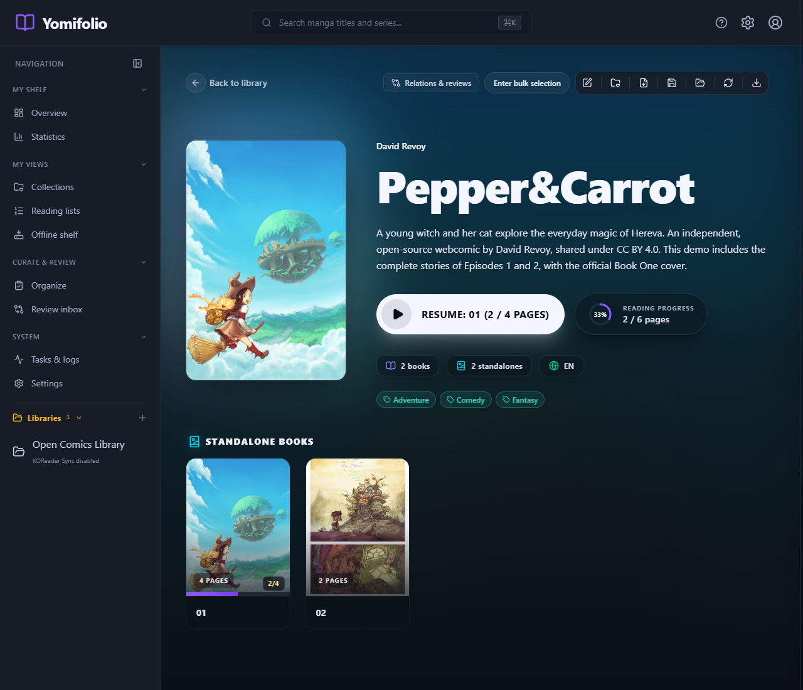
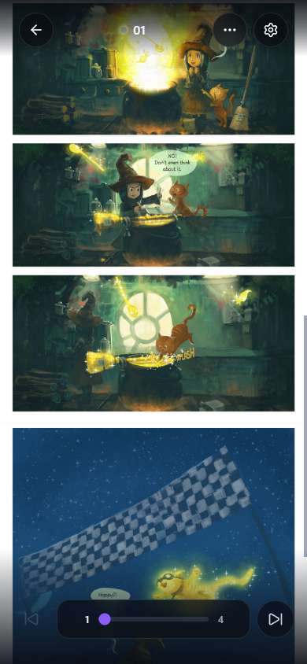

# Yomifolio

**Self-hosted manga & comic server · 自托管漫画与画集服务器**

[English](README.md) · 简体中文 | [下载](https://github.com/Nieole/yomifolio/releases/latest) · [快速上手](#快速上手) · [深入文档](#深入文档)

把硬盘上的漫画、画集压缩包整理成可浏览的系列书库，在浏览器阅读、下载到当前浏览器离线阅读，或按需接入 OPDS、Mihon API 与 KOReader 同步。不同客户端的能力各有边界，不意味着任意客户端都能同步阅读进度。

看真实封面挑下一本，从上次的位置继续读。截图采用 **Pepper&Carrot**、**《ブラックジャックによろしく》**、**Coffee For You** 和 **Superflu** 的公开授权素材，见[作者署名、许可与截图说明](images/README.md)。软件不附送漫画内容包。

## 为什么使用 Yomifolio？

- **藏书留在本地。** 扫描 ZIP/CBZ、RAR/CBR，以内嵌 SQLite 建立索引；基础管理与阅读不需要云数据库或大模型。
- **让藏书更容易找到。** 搜索系列和卷册，建立合集、智能筛选与阅读列表；先审核元数据建议，再决定是否应用。
- **按习惯阅读。** 桌面和手机支持翻页、双页对开与纵向瀑布流；可下载到当前浏览器离线阅读，或启用适配的客户端协议。
- **共享书库，不混淆阅读记录。** 各账号分别保存进度、书签、系列短评与阅读统计；管理员负责公共藏书和系统维护。

## 快速上手

1. 从 [Releases](https://github.com/Nieole/yomifolio/releases/latest) 下载适配平台的二进制：Linux AMD64、Windows AMD64 或 macOS ARM64。以发布页实际文件名为准；旧 release 可能仍叫 `manga-manager`，当前源码构建及发布工作流产物叫 `yomifolio`。本文与截图描述当前源码，下载版本的功能以其 release notes 为准。
2. 放进服务账号有写入权限的工作目录。Linux/macOS 执行 `chmod +x ./实际下载文件名` 后运行 `./实际下载文件名`；PowerShell 执行 `.\实际下载文件名`，文件名包含 `.exe`，不再追加扩展名。
3. 在服务器本机打开 [http://localhost:8080](http://localhost:8080)，创建首个管理员，在设置中添加藏书的**绝对目录**并扫描。请只使用有权存储和阅读的文件。网页支持简体中文和英文。

> **先在本机或可信网络初始化，再对外开放。** 默认监听 `0.0.0.0:8080`，不内置 HTTPS。未初始化时受保护的 Web API 拒绝访问，但任何能到达公开 setup 入口的人仍可能抢先成为管理员。公网部署使用 TLS 反向代理并配置可信代理和安全 Cookie，见[部署与安全](docs/getting-started.zh-CN.md#路径配置与安全)。

默认 `config.yaml` 位于**当前工作目录**，不是 `data/` 内。`-data-dir` **只改变日志目录**；数据库与缓存由配置决定，默认 `./data/manga.db`、`./data/cache`。详见[路径、配置与升级](docs/getting-started.zh-CN.md)。

## 从硬盘里的压缩包，到下一本想读的漫画

### 找得到，也整理得顺手

- **跨库搜索**系列、书籍的名称与标题，再按作者、标签、评分、出版状态和阅读进度等条件筛选书库。
- **不只依赖文件夹分类：**手动建立合集、保存智能筛选、把当前匹配结果固化为合集快照，或编排有先后顺序的阅读列表。
- **围绕系列看全貌：**卷册、作者、标签、简介与进度集中展示；为前传、续作、外传建立关系，并用关系图探索关联作品。

### 大屏看跨页，小屏顺着读

- **选择阅读节奏：**单页翻页、双页对开、Webtoon 纵向瀑布流；翻页模式可选从左到右或从右到左。
- **让画面适合屏幕：**适宽、适高、适屏，翻页缩放与拖动，主题、护眼暖色叠层、自动裁边和重采样滤镜。
- **随时接着看：**带备注书签、阅读进度与整本离线下载；断网时记录进度，重连后排队同步。

  
  

离线藏书保存在**当前浏览器**，需要 Service Worker / Cache Storage，通常要求 HTTPS 或 localhost；容量与回收行为取决于浏览器，登出或切换用户可能清理本机藏书，不能当永久备份。手机视图是开启触控模拟的真实浏览器截图，不是实体手机拍摄，见[素材署名与实拍说明](images/README.md)。

### 补全资料，决定权留在自己手里

按需接入 Bangumi、AniList、MangaDex、MyAnimeList、Comic Vine 等元数据源。逐字段比较当前值与候选值，查看来源和置信度，再单条或批量应用、驳回；不希望被覆盖的字段可以锁定。

可选 LLM 辅助补全元数据、提出主题分组与基于阅读偏好的推荐，建议仍需审核，基础管理和阅读不依赖 AI 服务。可导入压缩包中的 `ComicInfo.xml`；编辑后的元数据可写回 **ZIP/CBZ**，不支持写回 RAR/CBR。

### 共享藏书，各自记录阅读生活

管理员维护公共藏书与账号，每位读者分别保存阅读进度、书签、系列短评、阅读时长、连续阅读天数与分时段统计。账号隔离的是阅读记录，**不代表每个用户拥有私有书库分区**。

### 藏书变多，维护也有章法

- **按存储条件入库：**选择扫描档位与可选的目录监听，为 SSD、HDD、网络存储调整后台 IO，减少与阅读争抢资源。
- **先检查，再清理：**身份扫描支持按内容识别重复；选中的原文件可移到回收站而非永久删除。缺失记录清理有根目录不可用等保护，但不能替代备份。
- **后台工作看得见：**查看任务进度与日志，定位失败并重试支持的任务；外部书库对比帮助找出并传入缺失书籍，受支持的资料库路径迁移可在准备好目标文件后保留身份。

具体行为与边界见[藏书、阅读与维护功能指南](docs/features.zh-CN.md)。

## 客户端与集成

| 入口 | 能力 | 启用与限制 |
| --- | --- | --- |
| Web 阅读器 | 浏览、翻页/瀑布流、每用户进度与书签、本机离线藏书 | 会话 Cookie + CSRF；离线需要 Service Worker / Cache Storage，通常要求 HTTPS 或 localhost。 |
| OPDS 1.2 | 目录导航、原包获取与 PSE 分页流式 | **默认关闭**；启用后 HTTP Basic（站点用户名/密码）。目录 `/opds/v1.2/`；客户端是否支持 PSE 等要实测，不能据此承诺进度写回。 |
| Mihon API 与配套源扩展 | 系列/卷册、筛选、合集与阅读列表；配套源支持浏览、阅读与下载 | **默认关闭**；HTTP Basic，入口 `/api/mihon/v1`。构建、安装与发布前提见[配套扩展指南](extensions/mihon/README.md)。不属于上游扩展商店；独立源插件**不提供页级双向同步**。 |
| KOReader | kosync 设备进度保存、与藏书匹配后对账到站点用户 | **默认关闭**，自助注册也默认关闭；默认路径 `/koreader`，使用独立的每账户同步密钥，需绑定站点用户并匹配书籍身份。 |

管理员创建的新账号，必须先在网页完成首次改密才能使用阅读协议。任意第三方客户端或下载原包并不自动具备回传进度能力。

### 可选外部服务与画质增强

在线元数据源与远程 LLM 端点可能向外部服务发送藏书元数据，部分来源需要 API 凭证；也支持本地 Ollama。请只启用可信的服务。

低分辨率页图可按需使用 **waifu2x / Real-CUGAN**，在阅读时处理；需要另装可执行程序及适配的 Vulkan 硬件和驱动，不是基础阅读的必需项。详见[来源要求与可选工具](docs/features.zh-CN.md)。

## 深入文档

- [部署、配置、权限、备份与升级](docs/getting-started.zh-CN.md)
- [藏书管理、阅读器、客户端与可选工具](docs/features.zh-CN.md)
- [构建、测试与开发](docs/development.zh-CN.md)
- [配置模板](config.example.yaml) · [版本变化](CHANGELOG.md)

## 贡献与反馈

贡献与安全反馈约定见 [CONTRIBUTING.md](CONTRIBUTING.md)。故障和建议可[新建 GitHub issue](https://github.com/Nieole/yomifolio/issues/new/choose)，附版本、平台、复现步骤和脱敏日志，不上传密钥或私有藏书。安全问题请按[私密联系说明](SECURITY.md)反馈。

## 许可证

[Apache License 2.0](LICENSE) · Yomifolio contributors。第三方组件保留各自许可证，见[通知与待核验的发布事项](THIRD_PARTY_NOTICES.md)。代码许可证不授予第三方漫画或封面图片的使用权。

### 受限 MCP 访问

管理员在 **设置 → MCP 访问** 为真实账户签发独立凭据，查看、收紧资料库与五项独立能力限制，并可撤销。资料库不选即无访问权；普通用户仍只读，不能获得管理或付费模型权限。修改或重置密码会撤销该用户的全部 MCP 凭据；密钥仅在签发时显示一次，请安全保存。

服务器配置 `mcp.public_url` 为规范 HTTPS origin，通用 Streamable HTTP 客户端连接 `<origin>/mcp`，发送 `Authorization: Bearer <密钥>`。这不是 OAuth，不提供授权服务器发现或交互登录。`library_get_series` 参数如 `{ "series_id": 123 }`，仅返回授权资料库内系列的身份字段；扫描控制凭据还可调用 `library_start_scan`（library_id）、`library_get_run`、`library_wait_run`、`library_cancel_run`（run_id）及分页 `library_list_runs`。运行仅对所属凭据及当前限制可见。等待最长 30 秒，超时或断线不取消已接纳工作；撤权在排队放行前或执行安全检查点停止后续工作，不回滚已提交内容。准备扫描不串联独立封面/哈希任务。重试发起不是幂等保证，只有已有排队任务可能合并；重启保留中断历史但不自动重跑委托工作。已实测官方 Go SDK v1.8.0 客户端与 `2025-11-25` 协议，不保证特定 agent 产品或未测试版本的兼容性。

获授权 agent 可组合资料库、加入时间、缺失字段与明确系列条件，读取 ComicInfo、封面和有界选页缩略图，比较多个已配置来源。身份或版本有歧义时应报告，不静默积压提案或写入；明确确认身份、版本并选择字段出处后形成提案，再通过 `library_enrich_metadata` 补空、筛选追加内容标签与链接，并以站点原始评分计算缺失评分。作者校正仅改目标系列关联，不重命名共享作者；比较后可选归档页改善自动封面，保护人工封面、非空描述、已有评分和字段锁。同一系列操作的文字、作者与封面一起生效，不承诺整批原子。已有提案可部分接受或关闭剩余差异；关闭及安全撤销均不重新打开终态提案，逐系列报告实际结果。

RAR 证据（ComicInfo 线索与选页缩略图）比普通阅读更保守：只接受受支持、未加密、已知条目大小的标准单卷非 solid RAR4/5。全局或条目 solid、多卷/分片、未知大小、加密、SFX、服务/注释或未知头布局均在解码前拒绝；损坏或超出头预检预算（65536 块、累计 16 MiB 头、RAR5 单头 1 MiB）也不可用。ComicInfo 返回 `unavailable`，缩略图返回不可用/不安全错误，不回落原书下载。可接受的 RAR 仍有 16 MiB 字典/累计前置条目预算和 64 KiB ComicInfo 限制；ZIP 证据及普通 RAR 扫描、阅读（包括 solid）不变。

`library_assess_match` 同时要求独立内部模型能力和本次明确次数额度。**额度由 agent 转述，服务器不独立核验所有者批准或真实账单。** quota 是保守准入计数，不是金钱费用硬上限；失败、取消或结果未知的已准入调用也消耗次数。重连与同操作重放不刷新额度，重启保留消耗但不自动续跑或重发付费请求；耗尽后非模型操作仍可继续。模型标签只是辅助，不能充当身份确认或系列事实；验收未使用真实付费模型，也不声称特定 agent 产品兼容。

管理员在 **设置 → 元数据操作** 查询前后、来源及安全撤销；后续相关修改或锁会阻止 Undo。恢复快照和旧封面默认不自动到期。独立获权的 agent 可不经逐批确认自主清理：**丢弃撤销材料不可恢复，Undo 将不可用**，但保留最小审计、当前和共享图片。pending 结果可检查，由当前仍获权的原执行者以原请求键续办，不分配新操作替代原意图。先受保护后失去引用的图片、终态文件失败及没有收据的准备孤儿可能保守残留；这不是全缓存/孤儿扫描，也不删除藏书文件。

仅支持 stdio 的客户端可先执行 `go build -o mcp-proxy ./cmd/mcp-proxy`，配置启动该可执行文件，参数为 `--url https://your-service.example`，通过子进程环境变量 `YOMIFOLIO_MCP_TOKEN` 提供独立凭据。不要把密钥放入命令行或 URL；保护客户端环境/配置，环境传递不能防止本机特权进程检查。辅助进程不需要服务器配置、数据库或藏书访问权，只连接已运行的服务，共享工具和实时授权，stdout 仅输出协议。私网明文还须添加 `--allow-lan-http` 并启用下面的服务器选项；不可禁用 HTTPS 证书验证，不跟随重定向或环境代理。上游只支持本服务的 stateless JSON-response MCP，不是任意 SSE/有状态会话服务器。EOF 退出辅助进程并取消传输等待，不发送业务取消；断线不自动重放，重连后应查询已接纳运行，丢失响应不等于未接纳。

局域网明文必须显式设置 `mcp.allow_lan_http: true`，且 HTTP origin 使用字面的 private/loopback IP 或 localhost，仅接受 private/loopback 客户端。**内网流量被截获即可泄露密钥。** 不接受公网 HTTP 或明文 DNS 主机名。HTTPS 反向代理须保留配置的 Host、清除客户端转发头，正确设置协议和真实客户端 IP，并仅将实际代理地址加入 `server.trusted_proxies`；不能直接公开绕过代理的后端。LAN HTTP 经可信代理时也须报告私网客户端地址。不要在 URL、代理日志、调试请求/响应体中记录密钥，尤其不要记录 Authorization 和签发响应。Cookie Secure 的覆盖设置不能放宽 MCP 明文范围。
